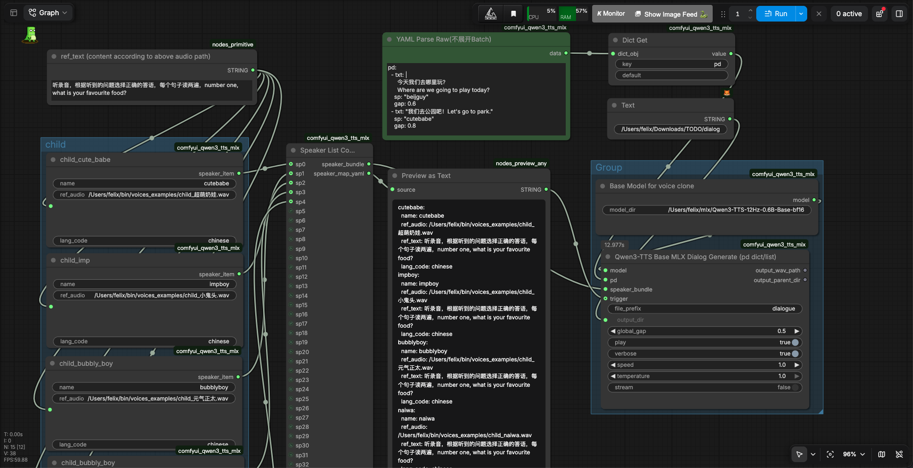

# ComfyUI-Qwen3TTS-MLX

ComfyUI custom nodes for Qwen3 text-to-speech using Apple MLX backend.

This project targets for Apple sillicon chips only, easy steps for comfyui string(multiline) to audio(.wav) files generation.

[Qwen3-TTS](https://huggingface.co/collections/mlx-community/qwen3-tts)

# Demos and workflows




# comfyui_qwen3_tts_mlx
ComfyUI custom nodes for **Qwen3‑TTS‑MLX**，基于Apple MLX后端的Qwen3‑TTS自定义节点集合。

> 适配 Apple Silicon Mac，使用 `mlx‑audio` 推理；包含原版单TTS生成节点 + **新增对话多角色合成节点**，支持YAML驱动的多人对话剧本，自动做角色音色映射、片段生成、gap静音拼接。

## ✨ 功能特性
1. **原有传统节点（兼容旧工作流）**
- `Qwen3 TTS MLX Loader`：模型加载，带全局缓存，避免重复加载大模型
- `Qwen3 TTS MLX Generate Base`：Base参考音频模式TTS，传入ref_audio/ref_text
- `Qwen3 TTS MLX Generate CustomVoice (9 speakers)`：内置9种预设音色
- `Qwen3 TTS MLX Generate VoiceDesign (by instruct)`：文本描述生成音色

2. **工具辅助节点**
- `YAML Parse Raw(不展开Batch)`：解析YAML字符串输出结构化ANY数据
- `Dict Get`：字典取值
- `List Get`：列表索引取值
- `Get List Length`：获取列表长度

3. 🆕 **对话剧本模块（本扩展核心）**
> 从YAML读取`pd`（prompt‑data），支持单人对象 / 多人数组剧本；每个角色独立配置参考音频、参考文本、语言；节点内部完成循环生成片段、gap停顿、wav拼接，**不再依赖ComfyUI外部For‑Each循环**。
- `Speaker Def (Base‑TTS reference voice)`：定义单个角色：`name(匹配pd.sp)` / `ref_audio` / `ref_text` / `lang_code`
- `Speaker List Combine`：最多50路输入汇聚多个SpeakerDef；输出`speaker_bundle`给对话节点，附带`speaker_map_yaml`调试预览输出；后接入同name角色覆盖前面定义
- `Qwen3‑TTS Base MLX Dialog Generate (pd dict/list)`：对话主生成节点
  - 输入结构化`pd`，支持两种格式：**单人dict / 多人list**
  - 每条对话可配置 `txt`朗读文本、`sp`角色名、可选`gap`本条结束后静音秒数
  - 角色的`lang_code`完全来自SpeakerDef定义，节点不再提供全局lang_code输入
  - `global_gap`兜底gap：当pd条目没有写gap字段时使用
  - 内部自动生成语音分片 + gap静音片段，拼接输出**单个完整wav文件**
  - 自动管理临时`.tmp_dialog_audio`目录，无论报错正常结束，自动清理碎片wav
  - 防御逻辑：全部对话条目被跳过，会输出一段global_gap时长静音wav，保证文件一定产出
  - 支持`trigger`输入用于DAG串行排队

## 📦 安装
### 方式1：ComfyUI‑Manager 安装（未来上架后）
> 暂未上架，使用方式2

### 方式2：手动git clone
```bash
cd ComfyUI/custom_nodes
git clone https://github.com/feishengfei/comfyui_qwen3_tts_mlx.git
cd comfyui_qwen3_tts_mlx
pip install -e .
```

依赖说明：
- `pyyaml>=6.0`
- `mlx‑audio`（需要用户自己按照mlx‑audio官方指引安装）
> `wave`为Python标准库，无需pip安装；`numpy`由mlx‑audio间接提供。

### 模型准备
下载Qwen3‑TTS‑MLX权重（Base版本用于对话节点），本地放到一个文件夹。
对话生成节点**只使用Base模型模式（ref_audio/ref_text），不使用CustomVoice内置音色**。

## 📖 使用教程：多人对话剧本工作流
### 1. 配置角色表
1. 添加多个 `Speaker Def`节点：
   - `name`：短英文标识，对应yaml pd里面的`sp`字段（例：`beijguy`、`cutebabe`）
   - `ref_audio`：角色参考音频绝对路径wav
   - `ref_text`：参考音频对应的转录文本
   - `lang_code`：该角色语言码，`zh_CN` / `en_US` / `auto`等
2. 全部SpeakerDef输出接到 `Speaker List Combine` 的 `sp0 sp1 sp2 ...`
3. `Speaker List Combine`输出：
   - `speaker_bundle` → 送入对话生成节点
   - `speaker_map_yaml` → 接Preview Text，调试查看最终生效角色映射表

> 💡提示：整套SpeakerDef + Combine可以打包为ComfyUI子图，跨工作流复用整套角色库。

### 2. YAML剧本格式
> 通过`YAML Parse Raw`节点输入yaml字符串，再用`DictGet`取出`pd`字段送给对话节点。

**单人模式（pd为对象dict）**
```yaml
a:
  fn: "demo_single"
  pd:
    txt: "你好，今天天气怎么样？"
    sp: "beijguy"
    gap: 0.5
```

**多人对话模式（pd为数组list，推荐）**
```yaml
a:
  fn: "demo_dialog"
  pd:
    - txt: |
        今天我们去哪里玩？
        Where are we going to play today?
      sp: "beijguy"
      gap: 0.6
    - txt: "我们去公园吧！Let's go to park."
      sp: "cutebabe"
      gap: 0.8
```
> ⚠️ YAML注意点：多行`|`块，文本内容必须再向内缩进；`sp`、`gap`必须和`txt:`保持同一层级，否则会被吃进txt字符串，导致条目被skip。

### 3. 对话主节点接线
`Qwen3‑TTS Base MLX Dialog Generate (pd dict/list)`
|输入|说明|
|---|---|
|`model`|来自`Qwen3 TTS MLX Loader`（必须加载Base模型）|
|`pd`|解析出来的pd结构化数据（dict / list）|
|`speaker_bundle`|来自`Speaker List Combine`输出|
|`file_prefix`|输出wav文件名前缀（不带`.wav`）|
|`output_dir`|输出文件夹路径|
|`global_gap`|兜底停顿，pd条目没有gap时使用|
|`speed/temperature/play/verbose/stream`|底层推理参数；trigger串行触发信号|

输出：
- `output_wav_path`：生成完成wav的绝对路径
- `output_parent_dir`：输出目录绝对路径

### 日志提示
运行控制台会打印：
```
[Qwen3‑Dialog] skip idx=0: missing txt or sp
[Qwen3‑Dialog] skip idx=1: sp key 'xxx' not in speaker map
```
出现该日志代表该条对话被跳过，请结合`speaker_map_yaml`预览输出排查yaml语法或者sp角色名是否匹配。

## 📁 目录说明
```
comfyui_qwen3_tts_mlx/
├── pyproject.toml
└── src/comfyui_qwen3_tts_mlx/
    └── nodes.py        # 全部自定义节点源码
```

## 📝 已知限制与注意事项
1. **对话节点仅支持Base模型模式**，依赖ref_audio/ref_text参考音色，不能直接使用CustomVoice内置voice枚举。
2. `Speaker List Combine`最大支持50个角色输入；不够直接修改源码常量`MAX_SPEAKER_INPUTS`。
3. 底层`generate_audio`参数`join_audio`在对话节点内部强制写死为`True`，避免自动追加`_000`后缀造成文件找不到错误。
4. 临时音频碎片自动放在`output_dir/.tmp_dialog_audio`，无论成功异常都会自动清理；不要手动存放业务文件到此目录。
5. YAML多行字符串`|`务必注意缩进，是最容易踩坑点。

## 🐛 排错清单
1. 节点菜单看不到新增节点：检查是否全部`ANY`改为字符串`"*"`；重启完整ComfyUI进程，不要只刷新浏览器。
2. `FileNotFoundError` ref_audio not found：检查SpeakerDef中参考音频路径是否绝对路径，文件真实存在。
3. 条目被skip：优先预览`speaker_map_yaml`输出，确认sp名字匹配；检查YAML缩进，不要把sp/gap吃进txt多行字符串。
4. `multiple values for keyword argument 'lang_code'`：对话节点已经移除lang_code输入框，lang_code全部由SpeakerDef角色定义提供。

## License
MIT License

